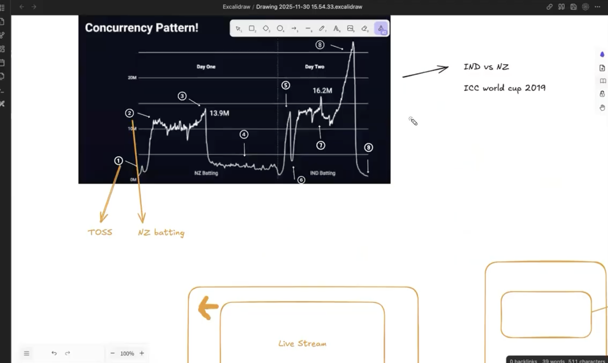

## Scalability

- It is the capability of the system to handle an increase in traffic, both in terms of memory and also in terms of latency.
- There will be patterns that each of the systems has in terms of scalability.
- During any LeetCode contest as well, the traffic
- Stranger Things final episode as well, there is huge traffic and there is a sudden jump in traffic.
- In UPI traffic patterns as well, the traffic will be lesser at night.
- In the IPL, like Dream11, there is huge traffic during the match.
- The traffic patterns vary from application to application.
  - **Hotstar**
    - Streaming platform

## Two Scalability Patterns

### 1. Vertical Scaling

- Better specifications and better compute for one system itself. When we increase the compute, we get better capability.
- There is a limit to the maximum you can scale.

### 2. Horizontal Scaling

- Instead of one machine, now I have 10 machines to distribute the traffic.
- There is no limit for the scalability.

#### Auto Scaling

- Hotstar didn't opt for auto scaling at all.
- What if AWS can't give 200 new machines? It will take time. From 16M to 25M, we won't get time to set up the new machines.
- Auto scaling can't work when we need new machines in a very short time.
- Hotstar had their own way: they pre-prepared new warm instances so that they don't have to waste time.
- We have to make sure to test, like spike testing, chaos testing and stress testing, and preemptively see what might go wrong. You can't wait for the match day to test everything.
- Testing infrastructure is also a good thing to focus on.

## Availability

- It defines how often a system is actually up, reachable and able to do the desired task.
- Availability SLA = `uptime / (uptime + downtime)`
