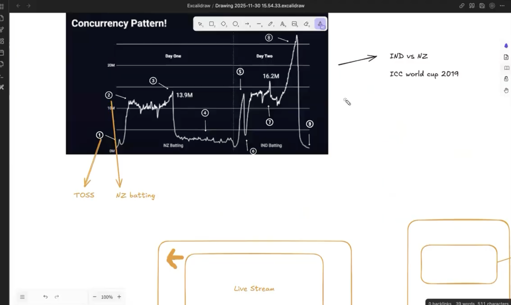

# HLD Revision Guide

A single place to revise everything in the `HLD` folder: system design basics, databases, scalability, and APIs.

**How to read this guide**

- Every point from your notes is here, regrouped under clear headings and written in simpler words.
- Each section starts with a **Quick recap**. Read only the recaps for a fast revision, or read the full section for the details.
- > 💡 **Added explanation:** blocks are short extras that are _not_ in your notes. They are only there to help understanding.
- > ⚠️ **Check this:** blocks mark places where the notes are unfinished, unclear, or look wrong. The original wording is kept, so nothing is lost.
- All of these are also listed at the end in [Notes to Double Check](#notes-to-double-check).

---

## Table of Contents

1. [Introduction](#1-introduction)
   - [1.1 Functional Requirements](#11-functional-requirements)
   - [1.2 Non-Functional Requirements](#12-non-functional-requirements) (Availability, Maintainability, Scalability, Fault Tolerance, Reliability)
   - [1.3 Domain Name System (DNS)](#13-domain-name-system-dns)
   - [1.4 Rate Limiting](#14-rate-limiting)
   - [1.5 API Rate Limit Strategies](#15-api-rate-limit-strategies)
   - [1.6 Latency and Throughput](#16-latency-and-throughput)
   - [1.7 Performance Testing](#17-performance-testing)
   - [1.8 k6 Demo](#18-k6-demo)
2. [DBMS](#2-dbms)
   - [2.1 Databases](#21-databases)
   - [2.2 SQL Basics](#22-sql-basics)
   - [2.3 Pagination, Constraints and Keys](#23-pagination-constraints-and-keys)
   - [2.4 Joins](#24-joins)
   - [2.5 Relationships](#25-relationships)
   - [2.6 Design DB for LeetCode](#26-design-db-for-leetcode)
   - [2.7 Which Database to Choose](#27-which-database-to-choose)
   - [2.8 Transactions](#28-transactions)
   - [2.9 ACID](#29-acid)
   - [2.10 Isolation and Isolation Levels](#210-isolation-and-isolation-levels)
   - [2.11 Locking](#211-locking)
   - [2.12 Distributed Cache-Based Lock](#212-distributed-cache-based-lock)
3. [Understanding Scalability](#3-understanding-scalability)
   - [3.1 Traffic Patterns](#31-traffic-patterns)
   - [3.2 Two Scalability Patterns](#32-two-scalability-patterns)
   - [3.3 Availability SLA](#33-availability-sla)
   - [3.4 Case Study: LeetCode](#34-case-study-leetcode)
4. [REST APIs](#4-rest-apis)
   - [4.1 What is an API?](#41-what-is-an-api)
   - [4.2 Ways to Make APIs](#42-ways-to-make-apis)
   - [4.3 REST](#43-rest)
   - [4.4 RPC](#44-rpc)
   - [4.5 gRPC](#45-grpc)
   - [4.6 tRPC](#46-trpc)
   - [4.7 GraphQL](#47-graphql)
   - [4.8 REST vs gRPC vs GraphQL](#48-rest-vs-grpc-vs-graphql)
5. [Notes to Double Check](#notes-to-double-check)
6. [Glossary](#glossary)

---

## The Big Picture

```text
HLD
├── 1. Introduction         -> what a system must do and how well (requirements, DNS, rate limits, latency)
├── 2. DBMS                 -> where the data lives (SQL, transactions, isolation, locking)
├── 3. Understanding Scalability -> how to survive heavy traffic (scaling, LeetCode case study)
└── 4. REST APIs            -> how the outside world talks to your system (REST, RPC, gRPC, GraphQL)
```

---

# 1. Introduction

> **Quick recap**
>
> - **Functional requirements** = the features. **Non-functional requirements** = how the system behaves (availability, maintainability, scalability, fault tolerance, reliability).
> - **Availability** is uptime. **Scalability** is handling more load, by vertical scaling (bigger machine) or horizontal scaling (more machines).
> - **DNS** turns names into IP addresses. It uses a hierarchy (Root, TLD, Domain, Hostname) and caching.
> - **Rate limiting** controls how many requests a client may send: fixed window, leaky bucket, token bucket, request quotas.
> - **Latency** = wait time for one request. **Throughput** = requests completed per unit of time.
> - Test performance with load, spike, stress and soak tests (tool: k6).

## 1.1 Functional Requirements

- These are the actual features we will be building.
- **Example, Uber:** start and end points, payment and all, probable final price.
- **Example, Uber wallet:** the user should be able to load money from a CC (credit card) or DC (debit card).
  - Users should be able to see the current balance.
  - Users should be able to see their history.
  - Users should be able to pay another user with this wallet.
- A **PRD** is usually made from the functional requirements.

## 1.2 Non-Functional Requirements

- These are not the crucial requirements.
- They describe the **behavior of the system**.
- Examples: Scalability, Availability, Maintainability, etc.
- Always take a balanced approach while taking the functional requirements.

### 1.2.1 Availability

- A highly available system has less downtime and is up and running all the time.
- Availability is the percentage of time for which some service or feature of the whole infrastructure is usable by the clients and can be operated in normal conditions.
- Example: live stream for Hotstar.
- It is simply the **uptime** of a system.

| Availability | Downtime per year | Downtime per month |
| ------------ | ----------------- | ------------------ |
| 99%          | 3.65 days         | 7.2 hr             |
| 99.9%        | 8.7 hrs           | 43.2 min           |
| 99.99%       | 52 min            | 4.3 min            |
| 99.999%      | 5.26 min          | -                  |
| 99.9999%     | 31.5 sec          | -                  |

- If we don't need the system to be highly available, that's fine, because it will incur some extra cost on us. We have to maximize our uptime.

> 💡 **Added explanation:** every extra "9" cuts the allowed downtime roughly 10 times, but it also costs more. That is why you only aim for high availability where the business really needs it.

### 1.2.2 Maintainability

- It refers to making the system as **evolvable** as possible without major disruptions.
- It takes a lot of effort and is a long-term thing.
- Things to think about:
  - How to structure the code
  - How to monitor the application
  - How to achieve modularity in the architecture
  - Any migration should not break anything else
  - A highly extendible system is also maintainable
  - Simple enough to migrate from MySQL to SQL
  - Right code structure

### 1.2.3 Scalability

- It is the ability of the system to handle an increasing amount of workload without hampering performance.
- Examples: a lot of user requests, etc.
- Let's say World Cup scale. The system should be ready enough to handle the increased load.
- Load testing, etc.

**Hotstar example**

1. Let's say Dhoni is batting, so there will be more traffic. People will come from different sources.
2. Let's say Dhoni gets out. Then people will click back and come to the homepage.
3. All those concurrent users will be calling the recommendation and history APIs on the homepage.
4. So now these users will move out. If these APIs are not ready enough, there will be a blunder.
5. Here, scalability matters a lot as well.
6. If we are looking at a gradual increase, that is fine. But if there is a sudden spike all at once, Hotstar can't spend time booting up servers, as it takes time. So what they do is keep **warm instances**.

**Types of scaling**

|       | Vertical Scaling                                     | Horizontal Scaling                                                              |
| ----- | ---------------------------------------------------- | ------------------------------------------------------------------------------- |
| Idea  | Get a more powerful machine which can take more load | Multiple instances of the same server                                           |
| Limit | The system has a limit                               | There is no limit for the scalability (see [3.2](#32-two-scalability-patterns)) |
| Cost  | A big machine costs more as well                     | -                                                                               |
| Extra | -                                                    | A load balancer on top reroutes the requests                                    |

**Horizontal scaling details**

- We attach a **load balancer (LB)** on top. The LB will be rerouting the requests, depending on the algorithm of the LB, so we distribute the load.
- Examples: Nginx, AWS ELB.
- Even the ELB can be a **SPOF** (single point of failure), so we have to set up a secondary ELB as well.

```text
                 +--> Server 1
Clients --> LB --+--> Server 2
                 +--> Server 3
```

**Auto Scaling**

- It means we provision our system, and these cloud services will provision automatically.
- AWS will automatically provision services, and it will kill the machines if the traffic is less.
- Min and max number of machines.
- Auto scaling can take a couple of minutes as well, that's a catch.
- When it reaches 60, spin up the new machine only to reduce the cold start issue.
- It depends on the situation: if it's Diwali orders, it can be gradual; if it's Diljit Dosanjh ticket sales, we can't do auto scaling there.
- ELB.

> ⚠️ **Check this:** "When it reaches 60" does not say 60 of what (for example 60% CPU). The last bullet "ELB" is a single word in the notes.

### 1.2.4 Fault Tolerance

- It's a technique to make the system highly available as well.
- Ways to achieve it: Replication, Load balancer, Backup systems, Monitoring.

### 1.2.5 Reliability

- Reliable systems perform their intended function correctly and consistently, even in the face of faults.
- The difference between available and reliable:
  - **Availability** asks: _is the system up?_
  - **Reliability** asks: _is the system doing what it should be doing?_
- These systems are available, but they are not reliable. Users tend to lose confidence in a system that gives wrong answers faster than in one that occasionally goes down.

## 1.3 Domain Name System (DNS)

**Why DNS exists**

- One mobile is related to one phone number, right? That's unique. So there we can have a phone book.
- Computers are identified by a unique **IP address**. An IP is a unique number given to a device.
- DNS is nothing but an **internet phone book**. It keeps a mapping of the domain names.
- We can't remember the IP. DNS does the job for us: it translates human-readable addresses to IP addresses.
- DNS infra has an internet handbook.
- DNS will return the IP address and the user will be redirected to that IP.

**Name servers and resource records**

- Everyone needs a group of servers. These servers are called **Name Servers**.
- **Resource records:**
  - These are individual records.
  - A resource record is the smallest record in the DNS DB, the smallest unit in the DNS.
- Name servers and resource records together allow DNS to effectively act as a lookup system, helping users reach the right websites or services on the internet.
- Three main components of a resource record: **Type**, **Name**, **Value**.

| Record type | Meaning                                                                                         |
| ----------- | ----------------------------------------------------------------------------------------------- |
| **A**       | IPv4 (32-bit address)                                                                           |
| **AAAA**    | IPv6 (128-bit address)                                                                          |
| **CNAME**   | Canonical Name record. An alias for another domain name, helping redirect one domain to another |
| **MX**      | SMTP mail servers responsible for receiving emails for a domain                                 |

**Other facts**

- The IP address of a device can change when it is connected to a different network, because most devices are assigned dynamic addresses.
- DNS is just a mapping, it doesn't allocate you an IP.
- DNS is like a domain name being registered. No two people will register the same domain.

### DNS hierarchy

```text
Root
 └── TLD            (.com, .net, .io)
      └── Domain    (algocamp)
           └── Subdomain   (blog.algocamp.io)
                └── Hostname   (www, ftp, mail)
```

- **Root** - Main directory for the main.
- **TLD** - Top Level Domain - one level of bifurcation, e.g. `.com`, `.net`.
- **Domain** - example, domain, algocamp. It sits beneath the TLD.
  - **Second level domain** aka **Subdomain** - `blog.algocamp.io`, etc.
- **Hostname** - www, ftp, mail.
- ISPs have a fixed pool of IP addresses. That's the reason they have to reuse those IPs and assign them to their clients. That's why we don't get a static IP for anyone.

### Iterative and recursive query resolution

**Example:** you type `www.algocamp.io` in your browser, and your computer needs its IP address.

- **Recursive query:** "Get me the final answer, I don't want to do the work."
  - Your computer asks the DNS resolver (usually your ISP's) for the IP of `www.algocamp.io`.
  - The resolver takes the full responsibility. It goes around, finds the answer, and gives you back only the final IP.
  - **Real-life example:** you ask a friend to find a shop's phone number. The friend asks around and comes back with the number. You never see the steps.
- **Iterative query:** "If you don't know, just tell me who to ask next."
  - The resolver asks the Root server: "What is the IP of `www.algocamp.io`?"
  - The Root server replies: "I don't know, but ask the `.io` TLD server."
  - The resolver asks the `.io` TLD server, which replies: "I don't know, but ask the name server of `algocamp.io`."
  - The resolver asks that name server, which knows the answer and replies with the IP.
  - **Real-life example:** you ask at the reception desk for a person's room. The reception says "Ask on the 3rd floor". The 3rd floor says "Ask at room 302". Room 302 finally helps you. Each one only points you to the next one.
- **In practice,** both are used together: your computer sends a recursive query to the resolver, and the resolver sends iterative queries to the Root, TLD and name servers.

```text
Browser --(recursive)--> Resolver --(iterative)--> Root server
                                  --(iterative)--> .io TLD server
                                  --(iterative)--> algocamp.io name server --> IP
```

### Caching in DNS

- It's like taking notes to remember, so you don't have to ask for it every time.
- So that we don't have to fetch again and again. We can ask the system itself.

1. **In the browser** - Chrome or Firefox have their own cache.
2. **OS cache** - Your computer's operating system also maintains a cache.
3. **DNS resolver cache** - Your ISP or DNS resolver also caches DNS information.

- Cache eviction policies mentioned: **LRU**, **LFU**.

> ⚠️ **Check this:** the line "Root - Main directory for the main" looks unfinished. The original numbering also jumps from "1. DNS Hierarchy" to "3. Caching in DNS" (there is no section 2).

## 1.4 Rate Limiting

- It's a way to limit the number of requests a service fulfills.
- A client using a particular service API that is configured to allow 500 requests per minute would block further incoming requests for the client if the number of requests the client makes exceeds the limit.

**Request flow**

```text
Client -> API Gateway -> Usage Plan -> Rate Limit
```

| Step                     | What it does                                                                                            |
| ------------------------ | ------------------------------------------------------------------------------------------------------- |
| **Client**               | The user or system making the API request                                                               |
| **API Gateway**          | The AWS service that handles incoming API requests                                                      |
| **Usage Plan**           | Where the API Key is checked and associated rate limits and quotas are retrieved                        |
| **Rate Limit Quota**     | The actual rate limits                                                                                  |
| **Allow / Deny Request** | Based on the rate limit and quota checks, the request is either allowed to proceed or denied            |
| **Backend Service**      | If the request is allowed, it's forwarded to the actual backend service that handles the business logic |
| **Throttle Response**    | If the request exceeds the rate limits, a throttle response is sent back to the client                  |

## 1.5 API Rate Limit Strategies

- It's a technique to control the number of requests a client can make to a server within a specified time window.

| Strategy              | How it works                                                                                                                                                                         | Pros                                                                                                   | Cons                                                                                                                                                     |
| --------------------- | ------------------------------------------------------------------------------------------------------------------------------------------------------------------------------------ | ------------------------------------------------------------------------------------------------------ | -------------------------------------------------------------------------------------------------------------------------------------------------------- |
| **1. Fixed window**   | A fixed time window is used to count the number of requests                                                                                                                          | Simple to implement and understand                                                                     | Potential business issues at the window boundaries, where users may be able to send many requests at the end of one window and the beginning of the next |
| **2. Leaky bucket**   | A request coming in is like adding a drop to the bucket. If the bucket overflows, the request is denied. Requests are processed at a consistent rate and excess requests are dropped | Simple to understand and implement. Smooths out the bursts by processing requests at a consistent rate | May lead to loss of some requests during burst traffic                                                                                                   |
| **3. Token bucket**   | One of the most commonly used algorithms. A bucket holds a number of tokens, and each request consumes one token. Tokens are replenished at a fixed rate                             | -                                                                                                      | -                                                                                                                                                        |
| **4. Request quotas** | You assign a quota to users or API keys. When the quota is exhausted, further requests are denied or charged at a higher rate                                                        | -                                                                                                      | -                                                                                                                                                        |

- **Fixed window example:** if you set a limit of 100 requests per hour, every hour the counter resets and the user can send up to 100 requests in the next hour. A limit of 100 req/hour resets at the top of every hour.
- **Request quotas example:** each user may have a quota of 1000 API requests per month.

## 1.6 Latency and Throughput

### Latency

- **Latency** is the measured end-to-end wait time for the client. We can calculate the latency of an API by measuring the time between sending a request and receiving a response.
- Mainly, we are taking a look at the total **response time**.
- Latency and response time are kind of the same thing.

### Throughput

- It measures the number of messages a server processes during a specific interval of time. It's kind of like the **rate of doing work**.
- Number of completed requests / time taken.
- The total number of requests per unit of time is **throughput**.

**Train and plane example** ([article](https://dsoguy.blogspot.com/2007/06/latency-v-throughput.html))

- A west coast processor needs 100 units of coal per hour. A plane carries 100 units and arrives in 12 hours, while a train carries 10,000 units and takes 48 hours.
- The plane has **lower latency** (12 hrs vs 48 hrs), so it is better for a single quick delivery.
- The train has **higher throughput**, since it delivers about 100 units per hour over a full round trip. This keeps the processor fed, so it is better for steady supply.
- So "which is faster?" depends on whether you care about latency or throughput. For infrastructure software, the goal is usually high throughput with acceptable latency.

## 1.7 Performance Testing

- Performance testing helps us in checking the **latency and throughput** of the application.

| Test                   | What we do                                                               | What it shows                                             |
| ---------------------- | ------------------------------------------------------------------------ | --------------------------------------------------------- |
| **Load testing** (Avg) | Send the normal, expected amount of traffic                              | Whether the app works well on a regular day               |
| **Spike testing**      | Suddenly send a huge amount of traffic in a very short time              | Whether the app survives the jump and recovers afterwards |
| **Stress testing**     | Keep increasing the traffic beyond the normal limit until the app breaks | The maximum load the app can take                         |
| **Soak testing**       | Run a normal amount of traffic for a very long time (hours or days)      | Slow problems, such as the app using more and more memory |

- Tool: **K6**.
- Then we get to know what scenarios are breaking.
- **P95** refers to the 95th percentile of the responses.

**How to improve latency and throughput**

- Reasons for latency:
  - Network latency
  - Application latency
  - Read/write latency
  - Geographic load balancing
  - Least connections
  - Minimizing network hops and cross-continent calls

**Application Load Balancer vs Network Load Balancer**

- In 99% of cases, we use the Application LB.

> ⚠️ **Check this:** the notes list "Geographic load balancing" and "Least connections" under "Reasons for latency". They read more like ways to improve it. Also, the notes do not explain the ALB vs NLB difference.

## 1.8 k6 Demo

The folder `(1) Introduction/k6-demo` has a very basic Node server (built-in `http` module, no packages) with k6 performance tests.

- **Routes**
  - `/` replies instantly.
  - `/slow` replies after 200ms.
- **Run**
  1. Install k6 once: `brew install k6`
  2. Start the server: `npm start`
  3. In another terminal, run one of the tests:
     - `npm run test:load`
     - `npm run test:spike`
     - `npm run test:stress`
     - `npm run test:soak` (takes about 1 hour)
- **Different port** (if port 3000 is busy):
  - `PORT=3001 npm start`
  - `BASE_URL=http://localhost:3001 npm run test:load`

---

# 2. DBMS

> **Quick recap**
>
> - Files do not work for many concurrent users, so we use **databases**. They are either **RDBMS (SQL)** or **NoSQL**.
> - RDBMS (MySQL, PGSQL, MSSQL) store tables, follow the SQL standard with their own flavours, and are **ACID** compliant.
> - Core SQL: create table, insert, select, update, delete, `LIMIT`/`OFFSET`, constraints, foreign keys, joins.
> - Pick the database by use case: graph, document, key-value, geospatial, relational, blob storage.
> - A **transaction** is all-or-nothing. **ACID** = Atomicity, Consistency, Isolation, Durability.
> - **Isolation levels:** Read Uncommitted, Read Committed, Repeatable Read, Serializable. Higher isolation is safer but slower.
> - Faster alternatives to serializable: **pessimistic locking**, **optimistic locking**, **Redis-based distributed lock**.

## 2.1 Databases

- **Traditional way:** file storage.
- The problem is that we might have concurrent users, and we can't handle files for the read and write requests.
- Let's say we maintain notebooks. One person will be using some registers and someone else will use other ones, and both will have different versions of their data.
- File storage was not good. That's why **databases** give you an organized way to store and retrieve data easily.
- Databases are divided into two categories:
  - **RDBMS (SQL)** - SQL stands for Structured Query Language.
  - **NoSQL**.
- **Database** is like the storage part. **DBMS** is the final part where the client will call.
- **SQL** is like the standard where it is defined that a query language should handle SQL.
- **SQL standard** documentation is the documentation which defines the rules if we have a database that I am preparing myself, like my own database, and I want to expose a query language in order to interact with it. We have dedicated databases which implement SQL, and mostly the ones which implement this standard come under the system of **RDBMS**.
- **RDBMS** stands for **Relational Database Management System**.
- Examples: PGSQL, MySQL, MSSQL. These depend on the SQL standard, and they have been derived from the SQL standard.
- All of these store data in tabular format or table-like format.
- They are all **ACID** compliant.
- All of those add their own flavour on top of the SQL standard.
- That's why the exact MySQL query syntax might not work in PGSQL.

## 2.2 SQL Basics

**Database and datatypes**

- `CREATE DATABASE FBDB` - Create a new database.
- `USE FBDB`
- SQL supports datatypes like `INT`, `BIGINT`, `TINYINT`, `DECIMAL`, etc.
  - **String** - `VARCHAR`
  - **JSON** - `JSON`
  - **Date and time** - `DATE`, `TIME`

**Schema** is just a blueprint of how our table will look.

**Create a table**

```sql
CREATE TABLE USERS (
  EMAIL VARCHAR(50),
  USERNAME VARCHAR(50),
  ID INT PRIMARY KEY AUTO_INCREMENT -- this is a unique identifier
);
```

- We can also make email the **primary key**. A primary key can never be duplicated.

**Describe the table**

```sql
DESC USERS;
```

**Insert into the table**

```sql
INSERT INTO USERS (
  USERNAME, EMAIL, PASSWORD
) VALUES ('SANKET', 'SANKET@GMAIL.COM', '123456');
```

**Insert data into the table**

```sql
INSERT INTO USERS (USERNAME, EMAIL, PASSWORD) VALUES ('SARTHAK', 'SJ@GMAIL.com', '123456');
```

**Select data from the table**

```sql
SELECT ID, EMAIL, USERNAME FROM USERS;
```

**Insert multiple data into the table**

```sql
INSERT INTO USERS (USERNAME, EMAIL, PASSWORD) VALUES (), (), ();
```

**Create a posts table** with `ID`, `CONTENT`, `USER_ID`, `CREATED_AT`

```sql
CREATE TABLE POSTS (
  ID INT PRIMARY KEY AUTO_INCREMENT,
  CONTENT VARCHAR(255),
  USER_ID INT, -- to whom the post belongs
  CREATED_AT TIMESTAMP DEFAULT CURRENT_TIMESTAMP
);
```

**Insert data into the table**

```sql
INSERT INTO POSTS (CONTENT, USER_ID) VALUES ('HELLO WORLD', 1);
```

**Select all the data from the table**

```sql
SELECT * FROM POSTS;
```

**Select with conditions**

```sql
SELECT * FROM USERS WHERE ID > 3;
```

```sql
SELECT * FROM POSTS WHERE USER_ID = 1 AND CONTENT = 'HEllo world';
```

```sql
SELECT * FROM POSTS WHERE CONTENT LIKE '%hello%';
```

**Sort the data**

```sql
SELECT * FROM POSTS ORDER BY CREATED_AT DESC;
```

**Delete the row from the table**

```sql
DELETE FROM POSTS WHERE ID = 1;
```

**Delete a table**

```sql
DROP TABLE POSTS;
```

**Update a row in the table**

```sql
UPDATE POSTS SET CONTENT = 'my world' WHERE ID = 2;
```

> ⚠️ **Check this:** the `USERS` table above is created with `EMAIL`, `USERNAME` and `ID` only, but the inserts use a `PASSWORD` column. The "insert multiple" statement uses empty `()` placeholders.

## 2.3 Pagination, Constraints and Keys

**Pagination**

- Let's say we have a lot of data, like 5 lakh or something.
- We can't fetch all the 5 lakh users to the frontend, as there will be a lot of load on the database.
- That's where **pagination** comes into play.
- I can technically fetch only a specific number of rows from the table. There we can use `LIMIT`.

**Fetch only 2 rows**

```sql
SELECT * FROM USERS LIMIT 2;
```

- We will add `OFFSET`. Offset means you start fetching the data from the offset number.

**Fetch only 2 rows starting from the 3rd row**

```sql
SELECT * FROM USERS LIMIT 2 OFFSET 4;
```

- Offset = 2 means start from 2, and 3 means start from the 3rd record.

> ⚠️ **Check this:** the heading says "starting from the 3rd row" but the query uses `OFFSET 4`. 💡 In SQL, `OFFSET n` skips the first `n` rows, so `OFFSET 4` starts at the 5th row and `OFFSET 2` starts at the 3rd row.

**Comments table**

```sql
CREATE TABLE COMMENTS (
  ID INT PRIMARY KEY AUTO_INCREMENT,
  CONTENT VARCHAR(355),
  USER_ID
);
```

**Deleting all rows**

- Not the preferred way:

  ```sql
  DELETE FROM COMMENTS;
  ```

- Delete all the rows from the table, because it will deallocate all the records, so we drop the table and recreate the table as well:

  ```sql
  TRUNCATE TABLE COMMENTS;
  ```

**Constraints**

- We should have taken some preemptive measures when we are creating the tables:

  ```sql
  CREATE TABLE LIKES (
    ID INT PRIMARY KEY AUTO_INCREMENT,
    USER_ID INT,
    CREATED_AT TIMESTAMP DEFAULT CURRENT_TIMESTAMP,
    LIKABLE_ID INT,
    LIKABLE_TYPE ENUM('post', 'comment')
  );
  ```

- I can insert a null user ID as well, therefore:

  ```sql
  CREATE TABLE LIKES (
    ID INT PRIMARY KEY AUTO_INCREMENT UNIQUE,
    USER_ID INT NOT NULL,
    CREATED_AT TIMESTAMP DEFAULT CURRENT_TIMESTAMP,
    LIKABLE_ID INT,
    LIKABLE_TYPE ENUM('post', 'comment')
  );
  ```

- That's why we are making sure that we are filtering the things out depending.
- This is called a **constraint** in MySQL.

**Foreign key**

- How do we make sure the user ID and the post ID are there or not? How do we verify whether the post exists or not, and whether the user exists or not?
- We have to make the user ID and the post ID like a **foreign key**.

```sql
CREATE TABLE COMMENTS (
  ID INT PRIMARY KEY AUTO_INCREMENT,
  CONTENT VARCHAR(255),
  USER_ID INT, -- the user who made the comment
  POST_ID INT, -- the post on which the comment is made
  FOREIGN KEY (USER_ID) REFERENCES USERS(ID),
  FOREIGN KEY (POST_ID) REFERENCES POSTS(ID)
);
```

- **Joins** allow us to combine the tables (next section).

> ⚠️ **Check this:** the first `COMMENTS` table has `USER_ID` with no datatype, and the sentence "we are filtering the things out depending" ends without saying depending on what.

## 2.4 Joins

- There are different types of **joins**, and not every type of join is supported in every DBMS. In MySQL the joins can be different from how the PGSQL joins work.
- The inner join for MySQL is different from the PGSQL inner join.
- SQL joins might not work for MySQL, as both are different.
- SQL is just a standard.
- Joins basically help us join the tables.

**Inner join**

- It will help us get only those records which are present in both the tables, for example comments and posts.
- There can be a case where some of the posts have comments and some do not.
- An inner join will basically give me the combination of comments and posts which are present in both the tables. It will give the **intersection**.

**Getting all the posts, even those without comments**

- Let's say I want all the common records and all the posts as well, like fetch all the posts which have comments and the ones that don't have comments as well.

  ```sql
  SELECT * FROM COMMENTS RIGHT JOIN POSTS ON COMMENTS.POST_ID = POST_ID;
  ```

  - Even if the comments are null, we will still get the posts.

**Full outer join**

- It is just like getting all the details, and it doesn't work in MySQL.

> 💡 **Added explanation:**
>
> ```text
> INNER JOIN       -> only rows found in BOTH tables (the overlap)
> RIGHT JOIN       -> all rows from the right table (POSTS) + matching rows from the left (COMMENTS)
> FULL OUTER JOIN  -> all rows from both tables
> ```

## 2.5 Relationships

| Relationship | Meaning      | Example from the notes                                                                                                                | Rule from the notes                                                      |
| ------------ | ------------ | ------------------------------------------------------------------------------------------------------------------------------------- | ------------------------------------------------------------------------ |
| **1:1**      | one to one   | A supplier has one account and one account belongs to one supplier. One supplier is only related to one record of one accounts record | In the accounts table, the supplier ID should be unique, and vice versa  |
| **1:N**      | one to many  | A book belongs to an author, but an author can have many books. A comment belongs to a post, but a post can have many comments        | In the book table, the author ID should be unique                        |
| **N:1**      | many to one  | -                                                                                                                                     | -                                                                        |
| **N:M**      | many to many | One physician can treat many patients, and one patient can be treated by many physicians                                              | We need a third table for the mappings. The third table is basically ... |

> ⚠️ **Check this:** the notes have no explanation under **N:1**, and the **N:M** note stops at "The third table is basically".

## 2.6 Design DB for LeetCode

| Table             | Columns                                                                                    |
| ----------------- | ------------------------------------------------------------------------------------------ |
| **User**          | `id`, `email`, `password`, `subscription_type`                                             |
| **Problems**      | `id`, `name`, `details` (markdown string, not HTML, because it can be written as a script) |
| **Tag**           | `id`, `name`                                                                               |
| **Problems_tags** | `problem_id`, `tag_id`                                                                     |
| **Submission**    | `user_id`, `problem_id`, `status`, `lang`, `code`                                          |

```text
User ──< Submission >── Problems >──< Tag
                         (linked through Problems_tags)
```

> 💡 **Added explanation:** `Problems_tags` is the "third table" for the many-to-many link between problems and tags (one problem has many tags, one tag belongs to many problems).

## 2.7 Which Database to Choose

- No one database will be able to solve the problem. There is a good variety of databases to solve problems.

| Situation (criteria)                                       | Choice                                                                             |
| ---------------------------------------------------------- | ---------------------------------------------------------------------------------- |
| Based on the team's knowledge                              | We can also prioritize a particular DB                                             |
| There is good knowledge of RDBMS                           | You can prefer **RDBMS**                                                           |
| Graph-like structure, like social media applications       | Graph-like databases, such as **Neo4j**, **InfiniteGraph**, etc.                   |
| Unstructured data, probably schemaless                     | Store it in the form of documents, so **document-based databases** are very useful |
| **Key-value pairs**, let's say user ID <-> connection data | **Redis**, **DynamoDB** are a good choice                                          |
| Geolocation data                                           | **Geospatial** DBs like **Redis** geospatial, **Firebase** geospatial, etc.        |
| Relational data which is also structured                   | **RDBMS** is good                                                                  |
| Transactional data                                         | **RDBMS** is also good                                                             |
| Bookings                                                   | In any case, there also you can use **RDBMS**. It is good, concurrency as well     |
| **File storage**: images, videos or any files              | **Blob storage** (binary large object), like AWS S3                                |

> ⚠️ **Check this:** the notes end this list with a single word, "SQL".

## 2.8 Transactions

- A transaction is a **logical unit of work** which comprises multiple steps in itself.
- In a transaction, all the sequence of steps should either complete successfully or none of them should complete. There cannot be a partial completion stage.
- In DB terms:
  - If all the steps of a transaction have completed, we call it a **commit**.
  - If some of them completed and a few did not, then the DB rolls back all the operations, and this situation is called **ABORT**.
- Not only **RDBMS** gives transactions, but even **MongoDB** gives transactions. But **RDBMS** has end-to-end support for transactions.

```sql
START TRANSACTION;
-- Code Steps
COMMIT;
```

**Transaction demo DB**

```sql
CREATE DATABASE TransactionDemoDB;

USE TransactionDemoDB;

CREATE TABLE ACCOUNTS (
  BALANCE INT NOT NULL,
  ACCOUNT_ID INT PRIMARY KEY AUTO_INCREMENT,
  ACCOUNT_HOLDER VARCHAR(50) NOT NULL
);

DESC ACCOUNTS;

INSERT INTO ACCOUNTS (ACCOUNT_HOLDER, BALANCE) VALUES ('ABC', 1000), ('XYZ', 2000);

SELECT * FROM ACCOUNTS;

START TRANSACTION;

UPDATE ACCOUNTS SET BALANCE = BALANCE - 200 WHERE ACCOUNT_HOLDER = 'ABC';

UPDATE ACCOUNTS SET BALANCE = BALANCE - 200 WHERE ACCOUNT_HOLDER = 'XYZ';

COMMIT;
```

## 2.9 ACID

**Reference:** <https://en.wikipedia.org/wiki/Isolation_(database_systems)>

| Property        | What it means                                                                                                                                                           |
| --------------- | ----------------------------------------------------------------------------------------------------------------------------------------------------------------------- |
| **Atomicity**   | The DB executes a transaction completely, or rolls back any partial completions. It ensures no partial updates. A good way to implement this is **log-based recovery**. |
| **Consistency** | Our data moves from a valid state to another valid state. DBs having high consistency will never leave your data in an inconsistent state.                              |
| **Isolation**   | A transaction property that defines how concurrent transactions should be handled.                                                                                      |
| **Durability**  | A guarantee provided by the DB such that if a transaction is committed, all the changes done by it will persist even if there is a DB crash.                            |

- **Isolation example:** let's say two concurrent users are trying to book a ticket for anything. There, isolation comes into play.
- Issues with concurrency:
  - **Dirty reads:** it occurs when a transaction retrieves a row that has been updated by another transaction that is not yet committed.
  - **Non-repeatable reads:** it occurs when a transaction retrieves a row twice and the row is updated by another transaction that is committed in between.
- **Serializable** is the highest isolation level, with lock-based concurrency control. Serializability requires read and write locks to be released at the end of the transaction. It will take more system resources.
- If any DB follows all these properties, then we call that DB **ACID compliant**, and it favours transactions in the database.

## 2.10 Isolation and Isolation Levels

- We study isolation to understand how DBs solve the problem of **concurrency**.
- **I** is the ACID property called **isolation**.
- Isolation says that if there are two or more transactions running at the same time, each one should behave as if it ran alone.
- If a DB is ACID compliant, it has built-in capabilities to control isolation.
- **Question:** what can happen if we don't take care of the isolation levels between multiple transactions?

### Isolation levels (solutions provided by MySQL)

- An isolation level means what degree of independence we will give to two transactions.
- MySQL gives 4 levels of isolation in general.

| Level                                      | What can still happen                                                    | Notes                                                                                                                                                                                             |
| ------------------------------------------ | ------------------------------------------------------------------------ | ------------------------------------------------------------------------------------------------------------------------------------------------------------------------------------------------- |
| **1. Read Uncommitted** (lowest isolation) | All the problems: phantom reads, dirty reads, non-repeatable reads, etc. | Like saying there is no isolation at all. For the further isolation levels, MySQL has to make extra efforts. Good option if only reads are going to happen and no writes, as it keeps things fast |
| **2. Read Committed**                      | Dirty reads will not happen, but the rest of the problems still exist    | Two identical reads in one transaction may still give different values (non-repeatable reads problem). Two transactions will never see an uncommitted ...                                         |
| **3. Repeatable Reads**                    | Phantom reads can occur                                                  | Neither the dirty read nor the non-repeatable read problem will occur                                                                                                                             |
| **4. Serializable** (highest isolation)    | None, all the above problems are solved                                  | Behaves as if two transactions are executed one after another instead of in parallel. Best to keep the isolation as Serializable as far as possible, but it is slow                               |

```sql
SET SESSION TRANSACTION ISOLATION LEVEL READ COMMITTED
```

**Question from the notes:** is there a way to achieve serializable-like safety with a faster approach? The answer is **locking** (next section).

> ⚠️ **Check this:** the Read Committed note ends with "will never see an uncommitted" and does not finish the sentence.

## 2.11 Locking

- **Locking** is a synchronization primitive that prevents state from being modified or accessed by multiple threads of execution at once.

### 2.11.1 Pessimistic locking

- "Pessimist" means prepare for the worst.
- We set the isolation level as Repeatable Read, then there will be no dirty read.
- Or, let's say we put it as Read Committed, and along with that, we take a **LOCK** on the row.
- Using `SELECT ... FOR UPDATE`, this statement will lock the row for that transaction till the transaction is committed.

**The deadlock problem**

```text
Txn1 -> A (locks) and B
Txn2 -> B (locks) and A
```

- Let's say Txn1 depends on resources A and B.
- Txn1 was taking a lock on resource A. By the time it was taking a lock on A, there was another transaction that was dependent on B and A, and this transaction took a lock on B.
- Now Txn1 took a lock on A and needs B, and Txn2 took a lock on B and needs A. Because they took the locks vice versa, this is a situation called a **Deadlock**.
- This is the issue with pessimistic locking.

```text
Txn1 holds A ──waits for──> B
Txn2 holds B ──waits for──> A      (each waits for the other, so neither can move)
```

### 2.11.2 Optimistic locking

- You keep a **version number** and a timestamp as a version number, and we are not going to take any lock.
- Now, if a row is updated, we update its version number.
- Here, we allow multiple transactions to happen in parallel, and the isolation is lowest.
- If any transaction goes through before we commit, we update the version number by +1.
- While other parallel transactions, before committing, are going to check if the number they have is the same as the version number at the current point of time in the DB. If yes, they commit; if not, they roll back.
- This is even faster than pessimistic locking.
- For hotel room counts, we can check the remaining count of the rooms.

> 💡 **Added explanation:** a small walk-through of the version check.
>
> ```text
> Row version = 5.  Txn A and Txn B both read it (version 5).
> Txn A commits first  -> checks version is still 5 -> OK -> writes, version becomes 6.
> Txn B tries to commit -> its copy says 5, DB now says 6 -> mismatch -> rollback (retry).
> ```

### Booking example (why locking is a problem for payments)

- Let's select a hotel, and I will be redirected to the details, and a dummy pending booking is created on my side.
- Then we complete the booking by making the payment.
- The payment operation is a very expensive operation, so we would like to keep it as fast as possible.
- Most of the users, if they reach here, expect their booking to complete.
- We don't want any expensive operations here. Hence, any serialization transaction or any locking cannot be afforded here.
- We don't want a bad user experience here, so we can't optimize the booking either.
- So, only when filling in the details do we put the concurrency control mechanisms, for a better user experience.
- Now, the issue is that locking a record is, in general, an expensive operation, because we are doing all the locking operations in the RDBMS itself.

## 2.12 Distributed Cache-Based Lock

- Lock on the **Redis** cache rather than the DB.
- User with ID 1 has selected room ID 10. If somebody else also tries the same, the app logic will come into play. The app will check in Redis whether the Airbnb is already taken or not, and if it's taken, then it will not allow any more bookings.
- Reading the cache is way better.
- We also have a **TTL** in Redis. If we put 30s as the TTL, then we will be able to delete the record if there is no confirmation. The moment the TTL expires, the record is deleted automatically and evicted.
- **Let's say there is a concurrent Redis entry at the same time and instance in the Airbnb:**
  - The best part of Redis is that writing in Redis is **serialized**. It will happen one after another, the Redis `SET` operation.
  - So, basically, we get serialized locking without locking in the database.
  - This is also easy to implement.
  - Redis can distribute the data among all the servers.

```text
User 1 picks room 10 -> app checks Redis -> free -> SET room:10 (TTL 30s)
User 2 picks room 10 -> app checks Redis -> taken -> booking not allowed
If User 1 never confirms -> TTL expires after 30s -> record deleted -> room is free again
```

---

# 3. Understanding Scalability

> **Quick recap**
>
> - **Scalability** = handling more traffic (memory and latency). Traffic patterns differ per app: Hotstar, UPI, IPL/Dream11, LeetCode contests.
> - **Vertical** scaling = bigger machine (has a limit). **Horizontal** scaling = more machines (no limit).
> - **Auto scaling** is too slow for sudden spikes. Hotstar used pre-prepared **warm instances** and tested early (spike, chaos, stress).
> - **Availability SLA** = uptime / (uptime + downtime).
> - **LeetCode case study:** prepared for 100K concurrent users with N+1 query fixes, indexes, random start dispersion, bulk writes through Redis, warm-up traffic and a bigger MySQL. Result: 75K took the test, about 1M submissions, all endpoints under 150ms, errors under 0.01%.

## 3.1 Traffic Patterns

- **Scalability** is the capability of the system to handle an increase in traffic, both in terms of memory and also in terms of latency.
- There will be patterns that each of the systems has in terms of scalability.
- During any LeetCode contest as well, the traffic ...
- Stranger Things final episode as well, there is huge traffic and there is a sudden jump in traffic.
- In UPI traffic patterns as well, the traffic will be lesser at night.
- In the IPL, like Dream11, there is huge traffic during the match.
- The traffic patterns vary from application to application.
  - **Hotstar:** streaming platform.



> ⚠️ **Check this:** the LeetCode bullet "During any LeetCode contest as well, the traffic" is unfinished in the notes.

## 3.2 Two Scalability Patterns

### Vertical scaling

- Better specifications and better compute for one system itself. When we increase the compute, we get better capability.
- There is a limit to the maximum you can scale.

### Horizontal scaling

- Instead of one machine, now I have 10 machines to distribute the traffic.
- There is no limit for the scalability.

### Auto scaling (the Hotstar story)

- Hotstar didn't opt for auto scaling at all.
- What if AWS can't give 200 new machines? It will take time. From 16M to 25M, we won't get time to set up the new machines.
- Auto scaling can't work when we need new machines in a very short time.
- Hotstar had their own way: they pre-prepared new warm instances so that they don't have to waste time.
- We have to make sure to test, like spike testing, chaos testing and stress testing, and preemptively see what might go wrong. You can't wait for the match day to test everything.
- Testing infrastructure is also a good thing to focus on.

> ⚠️ **Check this:** "From 16M to 25M" does not say what is being counted (probably concurrent users).

## 3.3 Availability SLA

- Availability defines how often a system is actually up, reachable and able to do the desired task.
- Availability SLA = `uptime / (uptime + downtime)`

> 💡 **Added explanation:** for example, if a service is up for 999 minutes and down for 1 minute, availability = 999 / 1000 = 99.9%.

## 3.4 Case Study: LeetCode

### The problem

- **Interview platform:** the platform used to handle a load of around 3K to 5K users. The peak load handled was 10K.
- **100K concurrent users** will appear for the test, within **2 weeks**. This was the problem statement.

### Existing architecture

- **Data storage:** single MySQL (5.6) on AWS RDS as the primary data source.
- **App server:** Ruby on Rails, multiple app servers running on multiple EC2, behind an Elastic Load Balancer.
- **User code submission:** Docker instances running on the same server.
- **Redis** (ElastiCache), and also for jobs as well.
  - **Async jobs:** Sidekiq.
  - AWS S3 and more for storing the test cases.
- Everything was in a monolith architecture. It's not the best monolith.

```text
Users -> Elastic Load Balancer -> Rails app servers (many EC2)
                                    |-- MySQL 5.6 (AWS RDS)
                                    |-- Redis (ElastiCache) + Sidekiq async jobs
                                    |-- Docker instances (code submissions, same server)
                                    '-- AWS S3 (test cases)
```

### Known optimizations

1. **Removing and improving on any N+1 query**
   - An N+1 query is a performance problem. Let's say that instead of fetching only a single time, you fetch repeatedly.
   - **Example:**
     - Fire a query: all the posts of a user.
     - Fire a query for each post -> Find = 1 query.
     - Fire a query for each post -> Find the recent 5 comments of the post = N queries.
     - Together, it makes an N + 1 query.
2. **Improvement on indexes**
   - Extra data structures to improve the search, but this won't solve the issue.
   - There might be a query pattern.
3. **Traffic pattern**
   - In a coding contest, we get the most traffic at the start of the contest and at the end of the contest.
   - Based on the traffic pattern, there is dispersion.
   - Strategy to handle safely the initial burst of requests.
   - What if we randomly distribute the users based on time? For some users, it will start at 3 PM, and for some, it will be 3 PM 1 min 2 seconds, and so on, up to 3:05.
   - It will be randomly distributed, and our initial load will be distributed, and our servers won't be overwhelmed.
4. **Bulk writes**
   - Usually, the read latency is less than the write latency.
   - First, cache the queries, and after every 10 seconds, you do the bulk writes, and we show them a loader until then. It's called eager loading.
   - Write the writes to a scaled Redis, and then a cron will take the queries from Redis and bulk write them into the DB. They vertically scaled their Redis server.
5. **Cold start problem**
   - All the TCP connections and the Redis and all, then the whole infra will take time to start up.
   - Instead of waiting, they started giving the test traffic to warm up the infra, like Locust, before 3 PM, so that the infrastructure doesn't take time to start when it's 3 PM.
6. **MySQL upscale**
   - Vertically scaled MySQL instance -> `m5.16xlarge`.

### Conclusion

1. After the load testing efforts -> the result was that the infra is prepared for **150K** concurrent users.
2. Finally, on the day of the contest -> **75K** took the test.
3. Approx. **1M** code submissions.
4. Across all endpoints **< 150ms**.
5. Errors **< 0.01%**.

> ⚠️ **Check this:** under "Improvement on indexes", the line "There might be a query pattern" is unfinished. "3 PM 1 min 2 seconds" is kept as written.

---

# 4. REST APIs

> **Quick recap**
>
> - An **API** is a contract that lets other systems use your software. It defines how to communicate, the inputs and outputs, and success or error cases.
> - Ways to make APIs: **REST**, **GraphQL**, **RPC** (also SOAP and more).
> - **REST** = recommendations: design around **resources**, each with a unique ID. Use HTTP methods (GET, POST, PUT, DELETE), plural resource names in URLs, query params for filtering, and versioning. JSON is the usual format. It is not type safe.
> - **RPC / gRPC** = call remote functions directly. gRPC is faster and type safe, with a small learning curve. **tRPC** is for TypeScript.
> - **GraphQL** = the client asks only for the fields it wants, through one `/graphql` URL.

## 4.1 What is an API?

- If a system wants to expose its own modules to the external world.
- Let's say we have a URL shortener service:
  - Create short URLs
  - Get all the short URLs
  - Edit a short URL
  - Delete a short URL as well
  - Given a short URL -> return the original URL
- So if I have to make a URL shortener, I need to have these features at least. I will be responsible for making this logic.
- Once these features are made, but if people want to use it, how do they do that?
- If there is a frontend team who is responsible for making the frontend, then the user will be able to shorten the URL.
- If the external world is not able to talk to my service, then there is no meaning.
- That's where **APIs** come into the picture.
- CodeChef internally used the service from SPOJ as the backend service.
- It will be our responsibility to expose the functionalities of this system so that the outer world can consume it. Maybe some frontend teams in our own organization, or some third organization who just need our logic.

**API** stands for **Application Programming Interface**. If we have a software and we want to define a contract for this software so that any other system can communicate to this software, then we need to use an API to describe the contract and expose the functionality. Inside the contract, you define:

- How to communicate
- What are the input and output expectations
- Any success or error scenarios to take care of

**Important points to remember when describing APIs**

- **Platform independence** (means the functionality is working in Windows but not working in Mac or Linux, etc. These should not happen at all). There will be a 1% chance of an engineer who wants to make an Android feature or maybe an Apple feature, like the bottom buttons in any app, and these are given by the Google engineers.
- **Service evolution** - If we want to add any logic anywhere for those APIs, we don't have to do a lot of modifications for those APIs, and probably we have to enhance.

**Note:** Generally, the clients will be consuming your APIs via some network interaction. Until and unless they download your logic into their system.

> ⚠️ **Check this:** the "Platform independence" note about the 1% chance, the "Service evolution" note (ends at "probably we have to enhance"), and the **Note** sentence are unclear or unfinished in the notes.

## 4.2 Ways to Make APIs

- The most relevant ways nowadays to prepare APIs are:
  - REST API
  - GraphQL
  - RPC
- There are more, like SOAP (Simple Object Access Protocol), etc.

## 4.3 REST

### What REST is

- **Representational State Transfer.** REST is a way to prepare APIs.
- REST is a set of recommendations that provide you architectural style details for designing APIs.
- Let's say the recommendations for the banks in India might vary from the recommendations that are given in London.
- 99% of the transactions that we do in India need OTP, but in the rest of the world, we don't need the OTP.
- REST just gives you recommendations.
- REST is independent of any underlying protocols.
- Mostly people use HTTP/HTTPS with REST, but you are free.
- Why not make our own REST? But the issue is the code should be understandable by other devs. Because everybody is following these recommendations, they will not need to read the recommendations.

### Recommendations of REST

- REST APIs need to be designed around **resources**, which are any kind of object, data, service or any real-life entity.
  - For our URL shortener service, `shortUrls` and `originalUrls` can be the resources.
- In a REST API, we need to write the implementation in a way such that every resource belongs to a unique ID that uniquely identifies the data about the resource.
  - If, say, in an e-commerce we have a product resource, then there will be some kind of `productId`, ex: iPhone 11, 33.
  - In our URL shortener, every short URL and original URL will be having an ID associated.
- Now, because we will have some kind of network interaction in REST APIs, that means we might need to send and receive data. We use **JSON** as the message format.
  - **Example:** if we have to fetch all the short and original URLs from our service, then the response payload of the API should be like:

    ```json
    {
      "shortUrlId": 22,
      "originalUrlId": 102,
      "shortUrl": "bitly/xyz",
      "originalUrl": "www.google.com"
    }
    ```

### HTTP methods

- For network interaction to be done via HTTP on a REST API, we define HTTP methods in a way that they auto-describe the APIs. It's not mandatory to follow this, and anything else is also just a recommendation.

| Method     | What the notes say                                                                                |
| ---------- | ------------------------------------------------------------------------------------------------- |
| **GET**    | If a REST API has the GET HTTP method associated, then probably you will be getting some resource |
| **POST**   | If a REST API has the POST HTTP method, then probably it will be creating some resource           |
| **DELETE** | Probably associating some resource                                                                |
| **PUT**    | (used in the URL examples below) updating the customer                                            |

### URL design

- The URLs to be defined for these network interactions are defined using the resource name and the unique identifier.

**Examples** (e-commerce, resource: customer)

| #   | URL                              | Method | What it does                                  |
| --- | -------------------------------- | ------ | --------------------------------------------- |
| 1   | `https://www.mykar/customers/1`  | GET    | Fetches the details of the customer with ID 1 |
| 2   | `https://www.mykar/customers`    | GET    | Fetches all the customers                     |
| 3   | `https://www.mykar/customers/12` | DELETE | Deletes the customer with ID 12               |
| 4   | `https://www.mykar/customers`    | POST   | Creates the customer                          |
| 5   | `https://www.mykar/customers/1`  | PUT    | Updates the customer                          |

- Resource names mentioned in the URLs are **plural**, and the hierarchy should also be like this: an order exists because of a customer, so probably the customer comes first.
- To describe an ID in a URL, we generally represent it as:
  - `http://www.mykart.com/customers/:customerId/orders/:orderId`
  - `http://www.mykart.com`
- If you want to send the data in the resource which is not directly related to the resource.

### Query params

- Sometimes we might need to send data to filter or sort the request output. To do that, a lot of times we can use **query params** in the URL.
  - `/search?price_start=52000&price_end=75000&category=electronics`
- Everything after the question mark is in the form of query params, which are key-value pairs separated by an ampersand.

```text
/search ? price_start=52000 & price_end=75000 & category=electronics
         \_______________ key=value pairs joined by & _______________/
```

### Versioning

- If we need to version the APIs, then we also put a version tag in the URLs.
  - `/v1/customers/customers/{customerId}/orders/{orderId}`
- We can put the version tag in the headers as well.

### Problems with REST

- REST has some serious problems, but still, because REST is very good to understand and all the ecosystem supports it.
- **Not type safe:** because JSONs are not type safe, you cannot enforce type in the JSON. We can do `roll_number: "23"`, and you cannot stop them from sending the data. That's why REST is not type safe. We have to manually validate it. Even if we use Java or TypeScript, we cannot get rid of this.

> ⚠️ **Check this:** the DELETE row ("Probably associating some resource") may be meant as "deleting". The URL `mykar` differs from `mykart` used later. The versioning example repeats `customers/customers`. The line "If you want to send the data in the resource which is not directly related to the resource" is unfinished.

## 4.4 RPC

- In Google, RPC is enforced.
- **Remote Procedure Calls**
  - Procedure calls means function calls.
  - Remote procedure calls means from my machine, I want to call someone else's function call.
- For REST, we need URLs and all the APIs and all.
- Internally, you don't need to know anything about all the methods and all.
- In REST, you have to define it yourself.
- In RPC, the creator of the API defines the function, and the consumer only calls those functions, that's it.
- In RPC, two machines communicate with each other using function calls, and the creator of an RPC writes the definition and implementation of the function, and the consumer calls the function.
- Internally, these functions are automatically converted to an HTTP request or whatever protocol is used, but we as developers do not need to care about putting the URL, HTTP method, etc.
- We delegate all those things, like methods and all, to the RPC.

## 4.5 gRPC

- gRPC is an RPC framework by Google.
- In REST APIs, we send and receive data via JSON. In gRPC, we don't send the data via protocol buffer. We can enforce types as well. gRPC makes our APIs type safe, and all the language systems handle it by themselves, so everything will be consistent altogether.

  ```protobuf
  message Person {
    optional string name = 1;
    optional int32 id = 2;
    optional string email = 3;
  }
  ```

- gRPC is relatively new, that's why.
- In REST, the URLs are resource-oriented. In gRPC, the functions are action-oriented.
- gRPC recommends that the function names should be pretty explicit.
- The issue is that there is a little bit of a learning curve.
- gRPC is much faster than REST.
- Proto buffers are light for the network.
- The binary conversion of protobuffer is much lighter than the JSON conversion, by the process called serialization and deserialization.
- gRPC by default uses the latest version of HTTP, but REST uses the HTTP 1.1 version, which is relatively slower.

> ⚠️ **Check this:** the notes say "In gRPC, we don't send the data via protocol buffer". That looks like the opposite of the rest of the section, which says protocol buffers (the `message Person` example) are what gRPC uses. It probably should read "we send the data via protocol buffer". Also, "gRPC is relatively new, that's why" does not say why what.

## 4.6 tRPC

- tRPC (<https://trpc.io/>).
- This is another RPC technology that is made for TypeScript.

## 4.7 GraphQL

- Let's say one client wants the student roll number and name. We made one endpoint for them. Tomorrow, one client wants address and marital status. The day after tomorrow, someone wants any other information about the student. Do I keep making new APIs for each of the clients? No, obviously not. And we can't send all the student info to the client, because REST is slow already, and JSON and all.
- GraphQL solves this, and our client only requests the fields that it wants, that's it, nothing else, and gets that. Our backend will be exposing all the fields by default and will only cherry-pick, that's it.
- The underlying network call will be HTTP only. It's just a communication standard, that's it. But the URL will be `/graphql`, and the payload will always change.
- On the server side, we only expose the data.
- **Apollo GraphQL:** <https://www.apollographql.com/>
- **Apollo Client:** <https://www.apollographql.com/docs/react>

## 4.8 REST vs gRPC vs GraphQL

_(Built only from the points in the notes above.)_

|                           | REST                                                                                             | gRPC                                                            | GraphQL                                                       |
| ------------------------- | ------------------------------------------------------------------------------------------------ | --------------------------------------------------------------- | ------------------------------------------------------------- |
| **Style**                 | Resource-oriented URLs                                                                           | Action-oriented functions (RPC)                                 | One `/graphql` URL, the payload changes                       |
| **Data format**           | JSON                                                                                             | Protocol buffers (binary), serialized and deserialized          | The notes only mention the request/response fields            |
| **Type safety**           | Not type safe, we validate manually                                                              | Type safe, types can be enforced                                | -                                                             |
| **Speed**                 | Relatively slower (HTTP 1.1)                                                                     | Much faster (latest HTTP, light payload)                        | -                                                             |
| **Who defines the calls** | You define URLs and methods yourself                                                             | The creator defines the functions, the consumer only calls them | The client picks only the fields it wants                     |
| **Learning curve**        | Easy to understand, whole ecosystem supports it                                                  | A little bit of a learning curve                                | -                                                             |
| **Fits when**             | Everyone follows the same recommendations and the code must be easy for other devs to understand | You want speed and type safety                                  | Different clients need different fields without new endpoints |

---

# Notes to Double Check

These are the places in your notes that look unfinished, unclear or possibly wrong. They are also marked in the sections above.

**1. Introduction**

- Auto scaling: "When it reaches 60" (60 of what?) and a lone "ELB" bullet.
- DNS: "Root - Main directory for the main" looks unfinished. Section numbering jumps from 1 to 3.
- Latency: "Geographic load balancing" and "Least connections" sit under "Reasons for latency". The ALB vs NLB difference is not explained.

**2. DBMS**

- The `USERS` table has no `PASSWORD` column, but the inserts use it. "Insert multiple" uses empty `()` placeholders.
- Pagination: "starting from the 3rd row" with `OFFSET 4`.
- `COMMENTS` table: `USER_ID` has no datatype. "filtering the things out depending" ends without saying what on.
- Relationships: nothing under **N:1**, and **N:M** stops at "The third table is basically".
- "Which database to choose" ends with a lone "SQL".
- Read Committed: "will never see an uncommitted" is unfinished.

**3. Understanding Scalability**

- "During any LeetCode contest as well, the traffic" is unfinished.
- "From 16M to 25M" does not say what is counted.
- "There might be a query pattern" is unfinished.

**4. REST APIs**

- "Platform independence" (1% chance), "Service evolution" (ends at "probably we have to enhance"), and the **Note** sentence.
- DELETE: "Probably associating some resource".
- URL typos or oddities: `mykar` vs `mykart`, and `/v1/customers/customers/...`.
- "If you want to send the data in the resource which is not directly related to the resource" is unfinished.
- gRPC: "we don't send the data via protocol buffer" looks like the opposite of what is meant. "gRPC is relatively new, that's why" is unfinished.

---

# Glossary

| Term                      | Meaning                                                                                           |
| ------------------------- | ------------------------------------------------------------------------------------------------- |
| **PRD**                   | Product Requirements Document, made from the functional requirements                              |
| **Uptime**                | The time a system is up and running                                                               |
| **SPOF**                  | Single Point of Failure, for example a single load balancer                                       |
| **LB / ELB**              | Load balancer / AWS Elastic Load Balancer                                                         |
| **Warm instances**        | Servers kept ready in advance so spikes don't wait for boot-up                                    |
| **DNS**                   | Domain Name System, the internet phone book mapping names to IPs                                  |
| **TLD**                   | Top Level Domain, for example `.com`, `.io`                                                       |
| **CNAME / A / AAAA / MX** | DNS record types (alias / IPv4 / IPv6 / mail servers)                                             |
| **Rate limiting**         | Limiting how many requests a client can send in a time window                                     |
| **Latency**               | End-to-end wait time (response time) for a request                                                |
| **Throughput**            | Number of completed requests per unit of time                                                     |
| **P95**                   | 95th percentile of the response times                                                             |
| **RDBMS**                 | Relational Database Management System (MySQL, PGSQL, MSSQL)                                       |
| **Primary key**           | A unique identifier column that can never be duplicated                                           |
| **Foreign key**           | A column that points to a row in another table and is checked against it                          |
| **Constraint**            | A rule on a table, such as `NOT NULL`, `UNIQUE` or a foreign key                                  |
| **Transaction**           | A group of steps that either all complete (commit) or all roll back (abort)                       |
| **ACID**                  | Atomicity, Consistency, Isolation, Durability                                                     |
| **Dirty read**            | Reading a row changed by another transaction that is not yet committed                            |
| **Non-repeatable read**   | Reading a row twice and getting different values because another transaction committed in between |
| **Phantom read**          | A repeated read that sees new or missing rows (still possible in Repeatable Read)                 |
| **Deadlock**              | Two transactions each holding a lock the other needs, so neither can proceed                      |
| **Pessimistic locking**   | Lock the row first (`SELECT ... FOR UPDATE`)                                                      |
| **Optimistic locking**    | No lock, use a version number and roll back on mismatch                                           |
| **TTL**                   | Time To Live, how long a Redis record stays before it is evicted automatically                    |
| **N+1 query**             | One query for the list, then one extra query for each item in it                                  |
| **Cold start**            | The time a system needs to warm up (connections, Redis, infra) before it is fast                  |
| **API**                   | Application Programming Interface, a contract for how other systems talk to your software         |
| **REST**                  | Representational State Transfer, a set of recommendations for designing APIs                      |
| **RPC / gRPC / tRPC**     | Remote Procedure Call / Google's RPC framework / RPC technology for TypeScript                    |
| **Protocol buffers**      | Light, binary message format used by gRPC                                                         |
| **GraphQL**               | The client requests only the fields it wants through a single `/graphql` URL                      |
| **SOAP**                  | Simple Object Access Protocol, another way to make APIs                                           |
